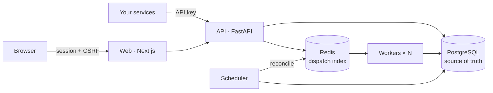

<div align="center">

# QueueForge

**Self-hosted background jobs you can actually see.**

Submit work over a REST API, let workers run it, and watch every attempt, retry and failure in a live dashboard.

[](https://github.com/aryan45sandilya/QueueForge/actions/workflows/ci.yml)


[Quick start](#quick-start) · [API](#using-the-api) · [How it works](#how-it-works) · [Docs](#documentation)

</div>

---

## Why QueueForge

Email batches, CSV transforms, nightly reports, calls to your own webhooks: work that shouldn't block a request, and shouldn't vanish silently when it fails.

| | |
|---|---|
| **Reliable** | Retries with backoff and jitter, timeouts, priorities, idempotency keys, crash recovery through leases, a dead-letter view grouped by error |
| **Scheduled** | Delayed jobs, plus recurring jobs by cron or interval with overlap skipping and *run now* |
| **Observable** | Live dashboard over SSE: throughput, failure rate, wait and run-time percentiles, queue depth, worker health |
| **Safe** | Jobs name a registered handler with a validated payload; submitted code is never executed. Projects are isolated |
| **Multi-user** | Optional open sign-up with email verification, password reset and per-account limits |
| **Webhooks** | `http.request` calls your URL with an HMAC signature and `Idempotency-Key`; private networks are blocked |

Built-in handlers: `http.request`, `notification.send`, `data.transform`, `report.generate` and `bench.synthetic`.

## Quick start

You need Docker. Copy the example config and set `QF_SECRET_KEY` to a long random value:

```bash
cp .env.example .env
```

```bash
docker compose up --build
```

In a second terminal, load a demo account and some sample jobs:

```bash
docker compose run --rm api queueforge seed
```

```bash
docker compose run --rm api queueforge demo-jobs
```

Open **http://localhost:3000** and sign in as `demo@queueforge.dev` / `queueforge-demo`. This account is for local use only; `seed` refuses to run in production. The API reference is at http://localhost:8000/api/docs.

<details>
<summary><b>Run without Docker</b></summary>

Needs Python 3.12+, Node 20+, PostgreSQL 14+ and Redis 5+. `scripts/devservices.sh start` can run portable PostgreSQL and Redis builds from `.devservices/`.

```bash
python -m venv .venv && .venv/bin/pip install -e "backend[dev]"
```

Create `backend/.env` from `.env.example`, then from `backend/` start each process in its own terminal:

```bash
queueforge migrate && queueforge seed
```

```bash
queueforge api --port 8000
```

```bash
queueforge worker --concurrency 8
```

```bash
queueforge scheduler
```

```bash
cd frontend && npm ci && npm run dev
```

`queueforge check-config` checks your settings and connections.

</details>

## Using the API

Create an API key in the dashboard under **Project & API keys**, then submit a job:

```bash
curl -X POST "http://localhost:8000/api/v1/projects/$PROJECT/jobs" \
  -H "Authorization: Bearer $QF_API_KEY" \
  -H "Content-Type: application/json" \
  -d '{"type": "http.request", "payload": {"url": "https://example.com/hook", "method": "POST", "body": {"hello": "world"}}}'
```

| Endpoint | Purpose |
|---|---|
| `POST /projects/{id}/jobs` | Submit a job (priority, delay, max attempts, idempotency key) |
| `GET /projects/{id}/jobs` | List, filter, sort and paginate |
| `POST …/jobs/{job}/cancel` · `…/retry` · `…/jobs/bulk` | Control jobs |
| `GET /projects/{id}/failures` | Dead letter, grouped by error |
| `/projects/{id}/schedules` | Recurring jobs |
| `GET /projects/{id}/events` | Live updates over Server-Sent Events |
| `GET /job-types` | Handlers with their JSON Schemas and examples |

All paths are under `/api/v1`. The dashboard's **Developer docs** page shows these examples filled in with your project ID.

## How it works



- **PostgreSQL is the source of truth.** Redis only holds job IDs to dispatch, and can be rebuilt from PostgreSQL at any time.
- **Workers claim jobs with compare-and-set** and hold 30 s leases that they renew. A worker that crashes loses its lease, and the job runs again elsewhere.
- **Delivery is at-least-once.** A job can run twice after a crash, so handlers receive the job ID and attempt number for deduplication. Submission is exactly-once per idempotency key.
- **If Redis goes down,** jobs are still accepted and workers poll PostgreSQL instead.

## Development

```bash
cd backend && pytest -q
```

```bash
cd frontend && npm test && npm run lint && npm run typecheck
```

Backend tests run against real PostgreSQL and Redis. Point them at yours with `QF_TEST_DATABASE_URL` and `QF_TEST_REDIS_URL` (the defaults match CI), and note that the test database is wiped. They include worker crashes, lease loss, claim races and Redis outages. CI runs everything, plus migrations, OpenAPI drift checks and a Docker Compose smoke test.

**Benchmark:** on a 2-core laptop, a single worker process completes about 60 short jobs per second, and two processes about 71. See [bench/](bench) to reproduce it.

## Deploying

Run one backend image in three roles (`api`, `worker`, `scheduler`) plus the web image, against PostgreSQL and Redis, with `queueforge migrate` as a release step. To let other people sign up, configure SMTP and the account limits.

→ [Operations guide](docs/operations.md) · [Running a public instance](docs/operations.md#running-a-public-instance-open-sign-up)

## Limitations

- Timeouts are cooperative: a handler that blocks the event loop can't be interrupted.
- Handlers are compiled in. On a shared instance, users run their own logic through `http.request`.
- Schedules are UTC only.
- There's no team invites, CAPTCHA or admin UI yet.
- Each worker process claims one job at a time, so add processes rather than slots to scale.

## Documentation

| | |
|---|---|
| [Architecture](docs/architecture.md) | Lifecycle, consistency model, failure modes |
| [Operations](docs/operations.md) | Deployment, scaling, troubleshooting |
| [ADRs](docs/adr) | [Source of truth](docs/adr/0001-postgres-source-of-truth.md) · [At-least-once](docs/adr/0002-at-least-once-delivery.md) · [Retries](docs/adr/0003-retries-backoff-dead-letter.md) · [Auth](docs/adr/0004-authentication.md) |
